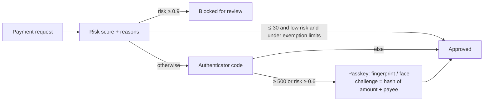

# SecurePay 3FA: risk-based three-factor authentication for online payments

[](https://github.com/lonewolf1621/THREE-FACTOR-AUTHENTICATION-FOR-ONLINE-TRANSACTIONS-/actions/workflows/ci.yml) [](https://github.com/lonewolf1621/THREE-FACTOR-AUTHENTICATION-FOR-ONLINE-TRANSACTIONS-/actions/workflows/codeql.yml) [](https://github.com/lonewolf1621/THREE-FACTOR-AUTHENTICATION-FOR-ONLINE-TRANSACTIONS-/actions/workflows/uptime.yml)

**Live demo:** https://three-factor-authentication-for-online.onrender.com (free hosting: the first visit can take about a minute to wake up) · **API docs:** `/docs`

A bank-style sign-in and payment flow that combines three independent factors and asks for more of them only when the risk or the amount calls for it:

| Factor | Type | How |
|---|---|---|
| Password | something you know | scrypt-hashed (OWASP parameters), lockout and rate limits |
| Authenticator-app code | something you have | TOTP (RFC 6238), works with Google/Microsoft Authenticator, 1Password; replay-protected; seeds encrypted at rest |
| Passkey with fingerprint or face | something you are | WebAuthn with user verification required; for payments the signature is bound to the amount and payee |

A logistic-regression **risk model** scores every login and payment from behavioural signals (new device, new network, unusual hour, recent failures, amount vs. usual, new payee, payment velocity) and explains each score.

## How payments are authorised



The rules follow the shape of PSD2 Strong Customer Authentication: the low-value exemption (RTS Art. 16: up to 30, while exempt payments since the last full authentication stay under 100 and 5 in number) and dynamic linking (RTS Art. 5: the passkey signs a challenge derived from the exact amount and payee).

**Try it:** create an account, set up an authenticator app and a passkey, then pay £20 (exempt), £150 (code) and £800 (code + fingerprint). Tick **Simulate risk signals** to make the same request look like an account takeover and watch the score, the reasons and the decision change.

## Owner admin

Accounts whose email is listed in `ADMIN_EMAILS` (set in the hosting dashboard) get an **Admin** panel, but it only opens after a sign-in with **all three factors**: an admin login always asks for the authenticator code *and* the passkey, whatever the risk score. The panel gives:

- **Stats:** users, factor adoption, suspended and locked accounts, active sessions, payments by status and risk band, events in the last 24 hours
- **Users:** suspend (ends their sessions and blocks sign-in), unlock, sign out everywhere, delete; admin accounts cannot be changed from the panel
- **Audit trail** across all users, filterable by event and email; every admin action is itself audited
- **Maintenance:** a banner for every visitor, close registration, pause payments, switch off the risk-simulation panel, clear demo data (admin accounts are kept and never auto-deleted)

## Engineering

- **FastAPI** service with a vanilla-JS front end (no inline script, strict Content-Security-Policy), SQLite storage, Docker image running as a non-root user.
- **Security controls and threat model:** [SECURITY.md](SECURITY.md): enumeration-safe errors, constant-work login for unknown accounts, hashed session tokens, SameSite=Strict cookies, HSTS, audit trail that never stores passwords, codes, seeds or full IPs.
- **Risk model:** [docs/risk_model.md](docs/risk_model.md). It is trained on **simulated** behaviour because no public labelled account-takeover dataset with these signals exists; on held-out simulated data the payment model reaches ROC-AUC 0.995 and challenges 90% of takeovers while challenging 0.5% of genuine payments. These figures validate the method, not real-world fraud performance.
- **Standard-library cryptography where it is enough:** scrypt and RFC 6238 are implemented on `hashlib`/`hmac` and tested against the RFC test vectors; WebAuthn uses `py_webauthn`; encryption at rest uses `cryptography` (Fernet).

## Automation (runs on GitHub, no local machine needed)

| Workflow | When | What |
|---|---|---|
| [`ci`](.github/workflows/ci.yml) | every push and PR, weekly | pytest (unit + end-to-end API), Bandit static analysis, pip-audit dependency vulnerabilities, risk-model retraining check, Docker build |
| [`codeql`](.github/workflows/codeql.yml) | every push, weekly | GitHub CodeQL security-extended queries for Python and JavaScript |
| [`uptime`](.github/workflows/uptime.yml) | every 6 hours | Signs up a throwaway account on the live site and checks enrolment, exempt, stepped-up and blocked payments, and security headers; failures open a GitHub issue labelled `uptime`, the next pass closes it |
| [`workflow-keepalive`](.github/workflows/workflow-keepalive.yml) | twice a month | Stops GitHub pausing the schedules after 60 quiet days |
| [Dependabot](.github/dependabot.yml) | weekly / monthly | pip, Actions and Docker updates, each checked by CI |

pip-audit has already earned its place: it flagged seven known Starlette vulnerabilities in the first dependency pin, which were fixed before deployment.

## Run locally

```bash
python -m venv .venv && source .venv/bin/activate
pip install -r requirements-dev.txt
uvicorn app.main:app --reload          # http://localhost:8000
pytest -q
python scripts/train_risk_model.py     # optional: needs requirements-train.txt
```

Passkeys need a secure context: `localhost` works; elsewhere use HTTPS. Set `ENCRYPTION_KEY` (a Fernet key) and `DB_PATH` for persistent storage, and `DEMO_MODE=false` to remove the risk-simulation panel.

## Project history

This started as an academic project (PHP + MySQL login, SMS one-time password, Android fingerprint check). Those samples are kept unchanged in [`legacy/`](legacy/). The rebuild replaces them with a tested, deployable service and fixes the original design's weaknesses: plaintext password storage, a predictable `rand()` one-time password with no expiry, an OTP step that did not re-check the password, and a fingerprint step that was only a stub on a deprecated Android API.

## Layout

```
app/main.py        API: registration, login step-up, enrolment, payments, audit trail
app/passwords.py   scrypt hashing and password rules
app/totp.py        RFC 6238 one-time codes
app/passkeys.py    WebAuthn registration/authentication and payment-bound challenges
app/risk.py        signals, scoring and explanations (coefficients in risk_model.json)
app/policy.py      which factors each login/payment needs
app/static/        front end
scripts/           risk-model training and the live smoke test
legacy/            original academic PHP/Android samples
```

Demo only: no real payments are made, and demo accounts are deleted after 3 days.
